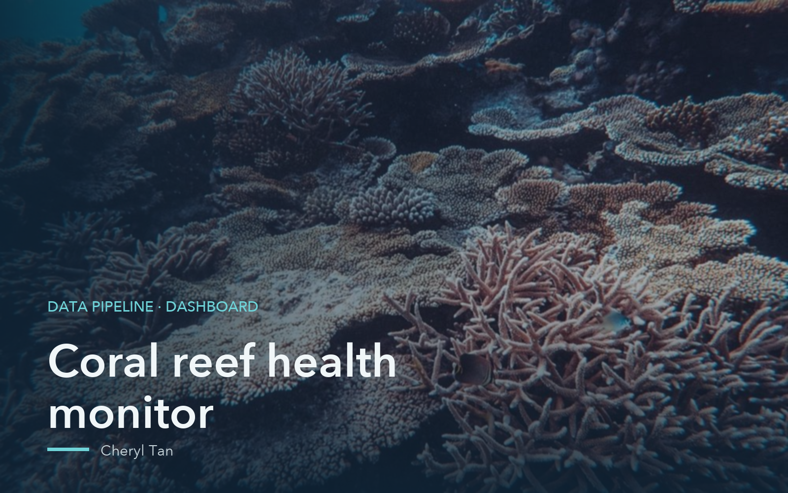

# Can reef bleaching risk be monitored with a free cloud stack?

A coral reef monitoring dashboard built on Neon PostgreSQL and Streamlit,
tracking sea surface temperature and bleaching risk for five reef sites.
It runs on simulated data and is a working prototype of the pipeline, not a
source of real reef findings.

## Project background

Coral bleaching is driven by sustained high sea temperatures, and reef
managers need a quick view of which sites are heating up. This project is the
analyst's prototype for that view: a small pipeline that stores daily sea
surface temperature (SST) and Degree Heating Weeks (DHW) readings in a cloud
database, and a dashboard that turns them into a bleaching risk label per day.

The build covers three areas:

- **Pipeline:** generate daily readings for five reefs and load them into Neon PostgreSQL without duplicates
- **Risk classification:** turn DHW into four bleaching risk levels, from No Risk to High Risk
- **Dashboard:** filter by reef and see headline metrics, temperature trends, a risk breakdown and a map

Links to the technical work:

- Data pipeline: [coral_reef_pipeline.py](coral_reef_pipeline.py)
- Dashboard: [dashboard.py](dashboard.py)
- Connection check: [test_connection.py](test_connection.py)
- Environment template (placeholders only): [env_template.txt](env_template.txt)

## Data structure and initial checks

One table, `reef_data`, holds one row per reef per day, with SST, DHW, the
risk label and the reef's coordinates. The pipeline generates **30 days of
readings for 5 reef sites** across Australia, the USA, Fiji and Mexico, and
every row is tagged `Simulated`. A unique key on reef and date means re-running
the load updates rows rather than duplicating them, and
[test_connection.py](test_connection.py) confirms the database is reachable
before the pipeline runs. The full schema is in [docs/METHODOLOGY.md](docs/METHODOLOGY.md).

## Executive summary

The prototype takes five reef sites from raw readings to a bleaching risk view
in three scripts: a connection test, a pipeline and a Streamlit dashboard. Any
SST above a **27.0 degree Celsius threshold** produces a DHW value, which is
mapped to No, Low, Moderate or High Risk at DHW cut-offs of 1, 4 and 8. All of
it runs on free tiers, with credentials held in environment variables rather
than in the code.

The dashboard shows four headline metrics (average SST, maximum DHW, High Risk
days and reefs monitored), a temperature trend, a risk distribution and a
reef map. No dashboard screenshot is included yet.

## Insights deep dive

### Pipeline

- **Five reef sites, 30 days each, loaded in one run.** The Great Barrier Reef
  is split into a northern and a central site, alongside Hawaii, Fiji and the
  Mesoamerican Reef.
- **Re-runs are safe for the data but not for history.** Inserts update on a
  reef and date match, yet the pipeline drops and recreates the table each run,
  so every run replaces what was stored.

### Risk classification

- **Risk is set by DHW at cut-offs of 1, 4 and 8.** A value of 8 or more is High
  Risk, 4 or more is Moderate, 1 or more is Low and anything below is No Risk.
- **DHW is zero unless SST passes 27.0 degrees Celsius.** Above that, it is the
  excess over 27.0 multiplied by 7, calculated per day rather than accumulated
  over a rolling window.

### Dashboard

- **One reef selector drives every metric, chart and the map.** The sidebar
  offers all reefs together or a single site.
- **The page fails visibly.** If the database connection fails, the app shows
  the error and stops instead of rendering empty charts.

## Recommendations

For a reef monitoring team considering this approach:

- The numbers are simulated, so the dashboard says nothing about real reefs.
  **Replace the generator with a real SST and DHW feed before drawing any
  conclusion about a site.**
- DHW is calculated from a single day's temperature. **Accumulate heat stress
  over a rolling window before relying on the risk labels.**
- The pipeline drops the table on every run. **Switch to append-only loads
  once real data is stored, so history is kept.**
- The dashboard filters by reef only. **Add a date range filter if the
  history grows beyond the current 30 days.**

## Assumptions and caveats

- **Simulated data.** SST combines a base temperature, a seasonal sine curve
  and random noise; it is not measured. Results change on every run.
- **Simplified bleaching risk.** The 27.0 degree threshold and the DHW
  formula are demonstration values, not a validated bleaching model.
- **Not a real-time system.** The dashboard queries the database on each
  load, but nothing is streamed in from sensors or satellites.
- **No tests beyond the connection check,** and no screenshot or live link yet.

## Technical detail

- How to run it: [docs/SETUP.md](docs/SETUP.md)
- Data generation, risk rules and schema: [docs/METHODOLOGY.md](docs/METHODOLOGY.md)

## Data and licensing

All readings are generated by the pipeline; no third-party data is used. The
database credentials are read from environment variables (`NEON_HOST`,
`NEON_DATABASE`, `NEON_USER`, `NEON_PASSWORD`, `NEON_PORT`) loaded from a local
`.env` file, which is never committed.
